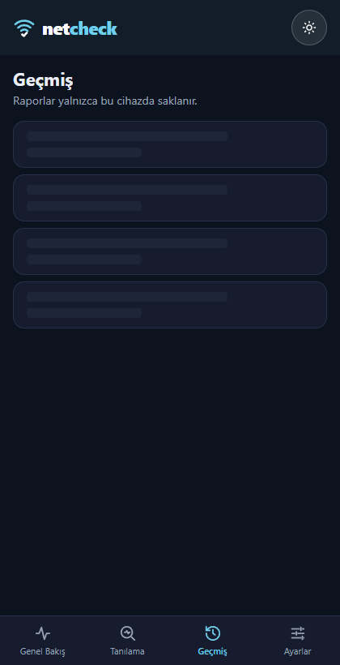
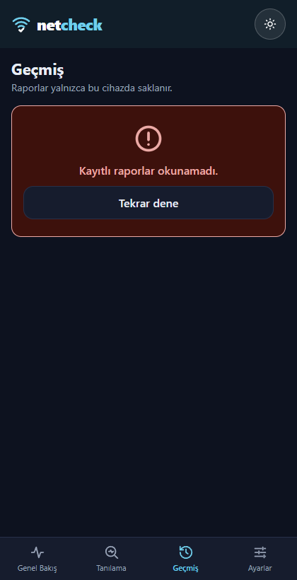
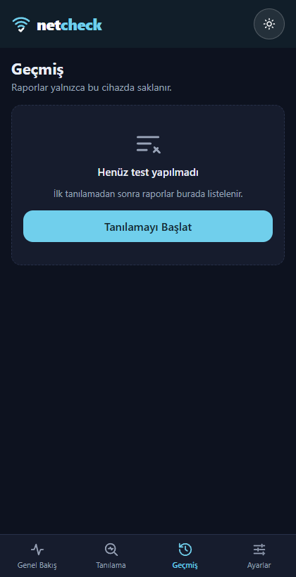
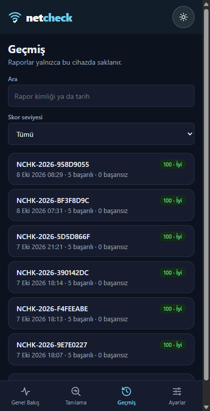

# Görev 13 — Liste Ekranı ve Üç Durum

Görev dosyası: [`docs/tasks/week-4/13-liste-ve-uc-durum.task.md`](../tasks/week-4/13-liste-ve-uc-durum.task.md). Dal: `feature/13-liste-ve-uc-durum`, Görev 12 dalının üstünde (zincirleme).

## Araç ve model

Claude Code, Claude Opus 5.5 (`claude-opus-5-5`), 2026-10-21. Windows, PowerShell. Arayüz denemesi iki yerde yapıldı:

- **Çalışan Windows uygulaması:** `bun run tauri dev`, WebView2 CDP üzerinden.
- **Rust'sız tarayıcı:** başsız Microsoft Edge (`--headless=new`), aynı geliştirme sunucusu.

## Şartname

- **Amaç:** Veri hazır değilken de ekran ne olduğunu söylesin: yükleniyor, hata, boş, dolu.
- **Kapsam dışı:** rapor detay ekranı (Görev 14); Tanılama ekranı; Rust.
- **Kabul ölçütleri:**
  - `src/lib/components/ui/` altında `Yukleniyor` (iskelet), `BosDurum` (başlık, açıklama, isteğe bağlı düğme), `HataDurumu` (mesaj ve "Tekrar dene").
  - Ana liste (Geçmiş) veriyi tek yükleme işlevinden alıyor ve dört halden yalnız birini gösteriyor.
  - Arama ya da süzgeç sonucu boşsa `BosDurum` ve süzgeci temizleme düğmesi.
  - Üç durumun metinleri dört dilde.
  - Dört halin ekran görüntüsü günlükte.
  - Aynı bileşenler ikinci bir listede.
  - Dört hali elle deneme yolu `docs/gelistirme-notlari.md` içinde (görev istemi madde 6).
- **Dokunulacak dosyalar:** üç yeni bileşen, `src/lib/types/ui.ts`, `src/lib/reports.svelte.ts`, `src/components/History.svelte`, `src/components/Overview.svelte`, `src/lib/sozluk.ts`, `docs/gelistirme-notlari.md` (yeni), `AGENTS.md` (indeks), `docs/klasor-mimarisi.md`, `docs/course-compliance.md`, `lat.md/`, `docs/kanit/13-liste-ve-uc-durum-*.png`.
- **Doğrulama adımları:** `bun run check`; `bun run build`; uygulamada dört hal, "Tekrar dene", saçma arama, süzgeç, dil değişimi; Rust'sız tarayıcıda ikinci listenin hata hali.

## İstem

Ayrı bir istem verilmedi; Görev 11–16 için verilen genel istem geçerli. Tam metin: [`11-veri-sozlesmesi.md`](11-veri-sozlesmesi.md), "İstem" bölümü.

## Plan

Genel istem ayrı onay turu istemediği için plan onay beklemeden uygulandı.

1. Bileşenlerin girdi tipleri `types/ui.ts` içine; bileşenler genel girdi alır, renkler `app.css` değişkenlerinden.
2. `reports.yukle()`: Geçmiş'in tek yükleme işlevi. Okunamayan ya da bozuk depoda hata fırlatır; önceden bu durumda sessizce boş liste dönüyordu, bu yüzden hata hali gerçekte hiç görünmezdi.
3. Geçmiş: dört hal, kart listesi (Görev 12), rapor kimliği/tarih araması ve skor seviyesi süzgeci. Süzgeç adreste tutulur (`?ara=&seviye=`), böylece Görev 14'te geri dönüşte korunur.
4. Geliştirme anahtarı `?durum=yukleniyor|hata|bos`; yalnız `import.meta.env.DEV`.
5. İkinci liste: Genel Bakış'taki arayüz listesi ve ekranın yükleniyor/hata hali.

## Düzeltmeler ve kararlar

- **Ana liste Geçmiş seçildi;** görev dosyası NetCheck için "test geçmişi boşken 'Henüz test yapılmadı'" örneğini veriyor.
- **Adres güncelleme zamanlaması:** ilk sürümde arama kutusunun `oninput` işleyicisi adresi yazıyordu. Bu işleyici `bind:value`'dan önce çalışırsa adrese eski değer yazılabilirdi. Adres değerlerden `$effect` ile türetiliyor; adresteki süzgeç okunmadan adres yazılmıyor.
- **"Tekrar dene" ve geliştirme anahtarı:** zorlanan hata adreste kaldığı için ilk sürümde "Tekrar dene" yine hata veriyordu. Düğme zorlamayı adresten kaldırıp gerçekten yeniden yüklüyor; görev § 3.2 ("liste geliyor mu?") böyle denenebiliyor.
- **Deneme aracı:** Agent Browser yeni oturum açarken takıldı ve bir önceki bağlantı denemesi onu Tauri penceresine bağlamıştı. Rust'sız tarayıcı denemesi bu yüzden başsız Edge ve CDP ile yapıldı.

## Doğrulama

- `bun run check`: 0 hata, 0 uyarı (önceden var olan 1 ipucu). `bun run build`: 21 sayfa, 0 hata. `lat check`: geçti. Değişen belgelerde 83 bağlantı: kırık yok. `git diff --check`: temiz.
- **Geliştirme anahtarı derlemede etkisiz:** `bun run preview` ile sunulan derlenmiş sitede `/gecmis?durum=hata` hata göstermedi; gerçek hal (bu tarayıcıda rapor yok, yani boş) göründü.
- **Çalışan uygulamada Geçmiş:**
  - `?durum=yukleniyor`: yalnız iskelet.
  - `?durum=hata`: yalnız `HataDurumu`.
  - `?durum=bos`: yalnız `BosDurum`.
  - Parametresiz: 6 gerçek raporla dolu liste ve arama alanları.
- **Hata halinde "Tekrar dene":** adres `/gecmis` oldu ve 6 rapor geldi.
- **Saçma arama ("qqzzxx"):** "Aramaya uyan rapor yok" ve "Süzgeci temizle" göründü, adres `?ara=qqzzxx` oldu. Temizleyince 6 rapor geri geldi ve adres `/gecmis` oldu. Süzgeç "İyi": adres `?seviye=iyi`, 6 rapor (altısı da 100 puan).
- **Arapça ve Farsça:** dört halin metinleri ve düğmeleri çevrildi, `dir="rtl"`.
- **İkinci liste (Genel Bakış):**
  - Uygulamada 5 arayüz kartı.
  - Rust'sız tarayıcıda `HataDurumu`: "Ağ bilgileri yalnızca NetCheck uygulamasında alınabilir…", `role="alert"`, "Tekrar dene".
  - Yükleniyor sırasında `Yukleniyor`; arayüz yoksa `BosDurum`.

### Dört halin ekran görüntüsü

Görüntüler araç tarafından çalışan Windows uygulamasından alındı (420 × 820, gece teması). Geçmiş ekranında ağ adresi yok; yalnız rapor kimliği, tarih ve skor görünüyor.

| Yükleniyor | Hata | Boş | Dolu |
|---|---|---|---|
|  |  |  |  |

## Bilinen sınırlamalar ve açık maddeler

- **Görev § 3'teki adımları öğrencinin kendisi yapmalı.** Yukarıdaki görüntüleri araç aldı; kontrol listesindeki "adımları kendim yaptım" maddesi öğrenciye ait.
- Dört dil kararı (C-2) eğitmen onayı bekliyor.
- Tanılama ekranı ve `labels.ts` metinleri henüz Türkçe.

## PR

[#39](https://github.com/frudotz/netcheck/pull/39) (taban: #38'in dalı).
